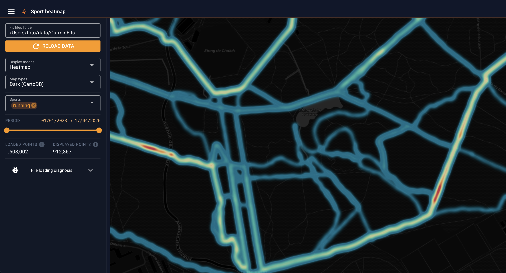

# Sport Heatmap

A Python web application that visualizes your geolocalized sports history as an interactive heatmap. It transforms raw `.fit` files into a filterable, high-performance map to explore your training patterns over time.



## Features

- **Three display modes**: Heatmap, Log-scale heatmap (highlights rarely-run paths), Scatter (individual GPS traces)
- **Sport filter**: Toggle activity types (running, cycling, hiking, …)
- **Date range slider**: Select the period to display with a double slider
- **Map styles**: Dark (CartoDB), OpenStreetMap, Satellite (ESRI), Terrain (OpenTopoMap)
- **Performance**: WebGL rendering via deck.gl — handles 1M+ GPS points smoothly
- **Caching**: Processed data is saved to `cache_data.parquet`. Use "Reload data" to rebuild after adding new files.

## Getting your `.fit` files

### Garmin

1. Log in to [Garmin Account Management](https://www.garmin.com/en-US/account/datamanagement/)
2. Select **Export Your Data** → **Request Data Export**
3. Wait for the download email (a few hours to a few days depending on your history)
4. Extract the ZIP and navigate to `DI_CONNECT/DI-Connect-Fitness-Uploaded-Files`
5. Paste that folder path into the "Fit files folder" input in the sidebar

### Other brands

Coros, Suunto, Polar, and Wahoo all support `.fit` file export. The app will work with any folder containing `.fit` activity files regardless of device brand.

- **Coros**: Training Hub → export activities as `.fit`
- **Suunto**: Suunto App → export to `.fit` via the web interface or third-party sync (e.g. intervals.icu)
- **Polar**: Polar Flow → export individual activities as `.fit`

## Installation

Requires **Python 3.9+**. Works on macOS, Linux, and Windows.

```bash
# Create and activate a virtual environment
python3 -m venv venv
source venv/bin/activate        # macOS/Linux
# .\venv\Scripts\activate       # Windows

# Install dependencies
pip install -r requirements.txt
```

## Running

```bash
python app.py
```

Open [http://localhost:8080](http://localhost:8080) in your browser.

## Configuration

Edit `config.yaml` to change defaults:

| Key | Default | Description |
|-----|---------|-------------|
| `paths.default_folder` | `~/data/GarminFits` | Pre-filled folder path in the sidebar |
| `paths.cache_file` | `cache_data.parquet` | Location of the Parquet cache |
| `performance.gps_rounding` | `5` | Decimal places kept on lat/lon (5 ≈ 1.1 m, 4 ≈ 11 m) |
| `ui.port` | `8080` | HTTP port |
| `ui.default_lat/lon/zoom` | Paris, zoom 11 | Initial map position |
| `ui.min_date` | `2023-01-01` | Earliest selectable date. Filters out aberrant GPS timestamps (e.g. `1970-01-01` recorded on failed syncs). Set to the date of your first activity. |
